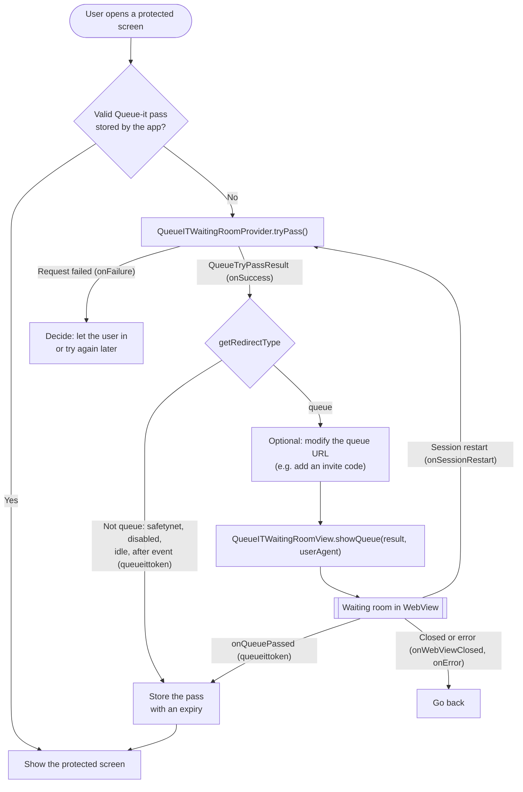

[  ](https://repo1.maven.org/maven2/com/queue-it/androidsdk/)

# Queue-it Android WebUI SDK

Library for integrating Queue-it's virtual waiting room into an Android app written in java.

## Sample app

A sample app to try out functionality in the library can be found on the [Releases](https://github.com/queueit/android-webui-sdk/releases) page.

## Installation

Before starting please download the whitepaper "Mobile App Integration" from GO Queue-it Platform.
This whitepaper contains the needed information to perform a successful integration.

Using Gradle:

```gradle
implementation 'com.queue-it.androidsdk:webui:3.0.0'
```

> **Artifact renamed in 3.0.0.** The SDK is now published as `com.queue-it.androidsdk:webui`. The previous artifact ids `com.queue-it.androidsdk:library` and `com.queue-it.androidsdk:library-androidx` are **discontinued** and relocate to `:webui` — update your dependency to the coordinate above.

## How to use the library (Mobile SDK integration only, no API protection)

The integration is done in two steps:

1. `tryPass` (on `QueueITWaitingRoomProvider`) checks the status of the waiting room and returns a `QueueTryPassResult`.
2. If the visitor has to queue, `showQueue` (on `QueueITWaitingRoomView`) opens the waiting room in a webview, using that `QueueTryPassResult`.

Between the two steps your app decides what happens next. For example, it can [modify the queue URL](#modifying-the-queue-url-before-showing-the-waiting-room) before the waiting room is shown.

As the App developer, you must manage the state (whether the user was previously queued up or not) inside the app's storage.

After you have received the `onQueuePassed` callback, the app must remember to keep the state, possibly with a date/time expiration.
When the user wants to navigate to specific screens on the app which needs Queue-it protection, your code checks this state/variable, and only call `tryPass` in the case where the user did not previously queue up.

Please note that when the user clicks back to navigate back to a protected screen, the same check needs to be done.

### Integration flow



### Listening to the waiting room events

The `QueueListener` receives the events from the waiting room once it is shown with `showQueue`.

> `Error` is `com.queue_it.androidsdk.Error`. Import it explicitly: with a wildcard import (`com.queue_it.androidsdk.*`) it clashes with `java.lang.Error`.

```java
QueueListener queueListener = new QueueListener() {

    // This callback will be called when the user has been through the queue.
    // Here you should store session information, so user will only be sent to queue again if the session has timed out.
    @Override
    public void onQueuePassed(QueuePassedInfo queuePassedInfo) {
    }

    // This callback will be called just before the webview (hosting the queue page) will be shown.
    // Here you can change some relevant UI elements.
    @Override
    public void onQueueViewWillOpen() {
    }

    // Required by QueueListener. When you use QueueITWaitingRoomProvider and QueueITWaitingRoomView,
    // the disabled state is reported in the QueueTryPassResult instead (see "Checking the status of the waiting room").
    @Override
    public void onQueueDisabled(QueueDisabledInfo queueDisabledInfo) {
    }

    // Required by QueueListener. When you use QueueITWaitingRoomProvider and QueueITWaitingRoomView,
    // an unreachable Queue-it is reported to QueueITWaitingRoomProviderListener.onFailure instead.
    @Override
    public void onQueueItUnavailable() {
    }

    // This callback will be called when the webview gets an SSL error (e.g. a custom queue domain with an invalid
    // certificate), or when the QueueTryPassResult has no queue URL or target URL. The error argument is always
    // Error.SSL_ERROR. Network failures while loading the page are retried automatically and don't trigger this callback.
    @Override
    public void onError(Error error, String errorMessage) {
    }

    // This callback will be called after a user clicks a close link in the layout and the WebView closes.
    // The close link is "queueit://close". Whenever the user navigates to this link, the SDK intercepts the navigation
    // and closes the WebView.
    @Override
    public void onWebViewClosed(){
    }

    // This callback will be called when the user clicks on a link to restart the session.
    // The link is 'queueit://restartSession'. Whenever the user navigates to this link, the SDK intercepts the navigation,
    // closes the WebView and calls this callback.
    // In this callback you would normally call tryPass/tryPassWithEnqueueToken/tryPassWithEnqueueKey again in order to restart the queueing.
    // Note: the queueITEngine argument is null when the waiting room was shown with QueueITWaitingRoomView.
    @Override
    public void onSessionRestart(QueueITEngine queueITEngine) {
    }
};
```

> If you enable the back button in the waiting room (`options.setBackButtonDisabledFromWR(false)`) and the user leaves the waiting room with it, no `QueueListener` callback is raised.

### Checking the status of the waiting room

To get the status of a waiting room, create a `QueueITWaitingRoomProvider` and call one of its methods:

- `tryPass()`
- `tryPassWithEnqueueToken(enqueueToken)`
- `tryPassWithEnqueueKey(enqueueKey)`

Calling any of these methods will result in executing the `onSuccess` or `onFailure` callback of the `QueueITWaitingRoomProviderListener` passed to the constructor of `QueueITWaitingRoomProvider`.

`onSuccess` receives a `QueueTryPassResult`. Use `getRedirectType()` to decide what to do:

- `queue`: the waiting room is active and the visitor has to queue. Show the waiting room by calling `showQueue` with the `QueueTryPassResult` (see [Showing the queue page to the visitor](#showing-the-queue-page-to-the-visitor)).
- `safetynet`: the visitor can pass without queueing. The queueittoken is available from `getQueueItToken()`.
- `disabled`, `afterevent` or `idle`: the waiting room is not queueing visitors. The result also carries a queueittoken. Most likely the application should still function, but the waiting room's state can change at any time, so session handling is important.

Every result that is not `queue` carries a queueittoken, so `isPassedThrough()` returns true for all of them: use `getRedirectType()`, not `isPassedThrough()`, to tell them apart. Any other redirect type is handled like `queue`, the same way the SDK's own `QueueITEngine` does it.

`onFailure` is called when Queue-it can't be reached (`Error.NO_CONNECTION`, or `Error.Queueit_NotAvailable` after the SDK's retries) or when Queue-it returns an HTTP 4xx response (`Error.INVALID_RESPONSE`). An HTTP 4xx response is most likely a misconfiguration: invalid customer ID, event alias ID or cname setting on the queue (GO Queue-it portal -> event settings). Here you decide if the application should function or not now that it has no Queue-it protection.

```java
QueueItEngineOptions options = QueueItEngineOptions.getDefault();

QueueITWaitingRoomView queueITWaitingRoomView = new QueueITWaitingRoomView(YourActivity.this, queueListener, options);

QueueITWaitingRoomProviderListener providerListener = new QueueITWaitingRoomProviderListener() {
    @Override
    public void onSuccess(QueueTryPassResult queueTryPassResult) {
        switch (queueTryPassResult.getRedirectType()) {
            case safetynet:
                // The user can pass without queueing: store queueTryPassResult.getQueueItToken() as for onQueuePassed.
                break;
            case disabled:
            case afterevent:
            case idle:
                // The waiting room is not queueing visitors: let the user continue.
                break;
            default:
                // queue (and any other redirect type, same as QueueITEngine): optionally modify the
                // queue URL first (see below), then show the waiting room.
                queueITWaitingRoomView.showQueue(queueTryPassResult, UserAgentManager.getUserAgent());
                break;
        }
    }

    @Override
    public void onFailure(String errorMessage, Error errorCode) {
        // Queue-it can't be reached, or the queue settings are invalid.
    }
};

QueueITWaitingRoomProvider queueITWaitingRoomProvider = new QueueITWaitingRoomProvider(
    YourActivity.this,
    customerId,
    eventIdOrAlias,
    layoutName, // @Nullable (optional)
    language, // @Nullable (optional)
    waitingRoomDomain, // @Nullable (optional)
    queuePathPrefix, // @Nullable (optional)
    options.getSdkUserAgent(), // @Nullable (optional)
    providerListener
);

try {
    queueITWaitingRoomProvider.tryPass();
}
catch (QueueITException e) { } // Gets thrown when a request is already in progress. In general you can ignore this.
```

### `QueueITWaitingRoomProvider` parameters

> Note the parameters are constructor parameters. The three `tryPass` variants have different parameters (none, `enqueueToken` and `enqueueKey`).

| Parameter                          | Required (Default value)                       | Description                                                                                                                                                                                  |
| ---------------------------------- |------------------------------------------------| -------------------------------------------------------------------------------------------------------------------------------------------------------------------------------------------- |
| activityContext                    | Yes                                            | Your `Context`                                                                                                                                                                               |
| customerId                         | Yes                                            | Your customer id                                                                                                                                                                             |
| eventIdOrAlias                     | Yes                                            | Id of the waiting room or alias                                                                                                                                                              |
| layoutName                         | No (Waiting Room's default theme)              | Layout name to use for the waiting room. If omitted, the Waiting Room's default layout will be used                                                                                          |
| language                           | No (Waiting Room's default language)           | Language id to use for the waiting room. If omitted, the Waiting Room's default language will be used                                                                                        |
| waitingRoomDomain                  | No (`{customerId}.queue-it.net`)               | Custom Waiting Room domain to use for the requests from Mobile to Queue-it. Can be a Proxy Domain, if you are running Queue-it Behind Proxy                                                  |
| queuePathPrefix                    | No (none)                                      | Queue Path Prefix to use, if you are running Waiting Room on same domain as your normal website. Requires waitingRoomDomain to also be provided. If not, then this parameter will be ignored.|
| userAgent                          | No (User agent of the Mobile's default webview)| Custom User Agent to use for requests from Mobile to Queue-it.                                                                                                                               |
| queueITWaitingRoomProviderListener | Yes                                            | Listener with callback functions. Must implement the `QueueITWaitingRoomProviderListener` interface.                                                                                         |

### Showing the queue page to the visitor

When waiting room is queueing the visitors, each visitor has to visit the waiting room page once. The queue page could be shown to visitors when it is necessary using `showQueue` method of `QueueITWaitingRoomView` class.
Before calling `showQueue`, the status of the waiting room should be already retrieved as described in [Checking the status of the waiting room](#checking-the-status-of-the-waiting-room) to make sure that the waiting room is ready.

sample code for showing the queue page:

```java
QueueITWaitingRoomView queueITWaitingRoomView = new QueueITWaitingRoomView(YourActivity.this, queueListener, options);
queueITWaitingRoomView.showQueue(queueTryPassResult, UserAgentManager.getUserAgent());
```
If you are using Behind Your Own CDN feature you must pass your `waitingRoomDomain` and `queuePathPrefix`:
```java
QueueITWaitingRoomView queueITWaitingRoomView = new QueueITWaitingRoomView(YourActivity.this, queueListener, options, waitingRoomDomain, queuePathPrefix);
queueITWaitingRoomView.showQueue(queueTryPassResult, UserAgentManager.getUserAgent());
```

The second argument of `showQueue` is the user agent of the webview showing the waiting room. Pass `UserAgentManager.getUserAgent()`: it is the user agent the SDK's own `QueueITEngine` uses, i.e. your custom user agent (`options.setSdkUserAgent`) or the device's default webview user agent, followed by the SDK version. Don't pass `options.getSdkUserAgent()` here: with `QueueItEngineOptions.getDefault()` it is an empty string, and the webview would then use no SDK user agent at all.

#### `QueueITWaitingRoomView` parameters

| Parameter         | Required (Default value)                 | Description                                                                                                                                                                                   |
| ----------------- | ---------------------------------------- | --------------------------------------------------------------------------------------------------------------------------------------------------------------------------------------------- |
| activityContext   | Yes                                      | Your `Context`                                                                                                                                                                                |
| queueListener     | Yes                                      | Listener with callback functions. Must implement the `QueueListener` interface.                                                                                                               |
| options           | No (`QueueItEngineOptions.getDefault()`) | Allows you to configure the SDK. Can disable the back button and set a custom User Agent for the web view and the http client. With `QueueItEngineOptions.getDefault()` the back button is disabled and the custom User Agent is empty (""); with `new QueueItEngineOptions()` the back button is enabled and the custom User Agent is not set. |
| waitingRoomDomain | No (none)                                | The same `waitingRoomDomain` passed to `QueueITWaitingRoomProvider`, if you are running Queue-it Behind Proxy.                                                                                |
| queuePathPrefix   | No (none)                                | The same `queuePathPrefix` passed to `QueueITWaitingRoomProvider`, if you are running Waiting Room on same domain as your normal website.                                                     |

Use `queueITWaitingRoomView.setViewDelay(delayInterval)` to delay showing the waiting room by `delayInterval` milliseconds.

### Modifying the queue URL before showing the waiting room

After `tryPass` returns a `QueueTryPassResult` with redirect type `queue`, and before you call `showQueue`, your app can change the queue URL. For example, you can append the `code` query parameter of an invite-only waiting room, or other query parameters.

`QueueTryPassResult` is read-only: build a new `QueueTryPassResult` with the same values and the updated queue URL, and pass that to `showQueue`. `showQueue` loads the queue URL as given.

Only add or change query parameters. Keep the scheme, host and path of the queue URL: the SDK's webview navigation rules are keyed on the queue host.

```java
private QueueTryPassResult withQueryParameter(QueueTryPassResult result, String name, String value) {
    String queueUrl = Uri.parse(result.getQueueUrl())
            .buildUpon()
            .appendQueryParameter(name, value)
            .build()
            .toString();

    return new QueueTryPassResult(
            result.getQueueItToken(),
            queueUrl,
            result.getTargetUrl(),
            result.getUrlTTLInMinutes(),
            result.isPassedThrough(),
            result.getRedirectType());
}

// In QueueITWaitingRoomProviderListener.onSuccess, when the user has to queue:
QueueTryPassResult updatedResult = withQueryParameter(queueTryPassResult, "code", inviteCode);
queueITWaitingRoomView.showQueue(updatedResult, UserAgentManager.getUserAgent());
```

> If you already know the invite code before calling `tryPass`, use [`setInviteCode`](#invite-only-waiting-rooms) instead: the SDK adds the code to the queue URL for you. Don't add a `code` parameter that is already in the queue URL.

### Invite-only waiting rooms

If your waiting room is configured as invite-only, visitors need to present an invite code (the `code` query parameter on the waiting-room URL). Pass that code to the `QueueITWaitingRoomProvider` before calling `tryPass()`, and the SDK will append it to the queue URL in the `QueueTryPassResult`:

```java
queueITWaitingRoomProvider.setInviteCode("<your-invite-code>");
try {
    queueITWaitingRoomProvider.tryPass();
}
catch (QueueITException e) { } // Gets thrown when a request is already in progress. In general you can ignore this.
```

`setInviteCode` accepts a `String`; passing `null` or an empty string clears any previously-set code.

#### Capturing the invite code from a deep link

Capturing the code from the link your user opened (App Link, custom URL scheme, push payload, manually pasted text, etc.) is the app's responsibility — the SDK only consumes the resulting string. A minimal example pulling `code` from the launching `Intent`:

```java
@Override
protected void onCreate(Bundle savedInstanceState) {
    super.onCreate(savedInstanceState);
    // ...
    applyInviteCode(getIntent());
}

@Override
protected void onNewIntent(Intent intent) {
    super.onNewIntent(intent);
    setIntent(intent);
    applyInviteCode(intent);
}

private void applyInviteCode(Intent intent) {
    if (intent == null) return;
    Uri data = intent.getData();
    if (data == null) return;

    String code = data.getQueryParameter("code");
    if (!TextUtils.isEmpty(code)) {
        queueITWaitingRoomProvider.setInviteCode(code);
    }
}
```

You also need an `<intent-filter>` in your `AndroidManifest.xml` matching the URL pattern you want to handle. See the `<intent-filter android:label="invite link">` in [`demoapp/src/main/AndroidManifest.xml`](demoapp/src/main/AndroidManifest.xml) for an example manifest entry. (The demo app's queue handling still uses the legacy `QueueITEngine.run`; integrate the waiting room with `tryPass` and `showQueue` as described above.)

### QueueItEngineOptions

The waiting room view can be configured if you use the `options` argument in the `QueueITWaitingRoomView` constructor. Here's an example.

```java
QueueItEngineOptions options = new QueueItEngineOptions();

// Use this if you want to disable the back button when the waiting room is shown
options.setBackButtonDisabledFromWR(true);

// Use this if you want to set a custom User Agent. 
// The user agent will be used by the WebView when the waiting room is shown, and for requests from the mobile app to Queue-it.
// Pass options.getSdkUserAgent() as the userAgent of QueueITWaitingRoomProvider, and UserAgentManager.getUserAgent()
// (the same value QueueITEngine uses) as the webViewUserAgent of showQueue.
options.setSdkUserAgent("<user-agent>");

// ------ //

// If null is provided for the QueueItEngineOptions, the default options will be used:
QueueItEngineOptions.getDefault();
```

### Recovering a queue pass after the app is killed (process death)

While a user is in the waiting room, Android may kill your app's process if it is backgrounded and the device is low on memory (common on low-RAM devices and aggressive OEM battery managers). If the user is passed through the queue around that time, the pass would otherwise be lost — the in-memory `QueueListener` no longer exists, so the user returns to your app but is never let in and has to restart the app.

To handle this, the SDK persists the pass to disk (best-effort) the moment it completes. Call `QueueITEngine.consumePendingPass(context, queueListener)` from your launching Activity's `onResume()` (or `onCreate()`):

```java
@Override
protected void onResume() {
    super.onResume();
    // Deliver a queue pass that completed while our process was killed in the background.
    QueueITEngine.consumePendingPass(this, queueListener);
}
```

If a pass completed while your process was gone, it is delivered to your listener's `onQueuePassed(...)`; otherwise it does nothing. It is safe to call on every resume: the stored token is read-and-cleared atomically, so a pass is delivered **at most once** and will not double-fire with the live delivery path. Returns `true` if a pending pass was delivered, `false` otherwise.

> **Note:** the token is cleared *before* your `onQueuePassed(...)` runs, so if your handler throws, the pass is **not** redelivered on a later resume — keep the handler robust. Persistence is best-effort (a failed disk write is not retried), so treat this recovery as a safety net on top of your own session handling, not a guaranteed transaction.

## Client-side mobile integration with Queue-it Behind Proxy (Bring your own CDN)

> Note: This only applies if you are using the Mobile SDK as a client-side protection only. I.e. this does not apply if you are protecting the API endpoints your Mobile app is using.

> If you have server-side Queue-it protection on your API endpoints, please see section [below](#mobile-sdk-integration-with-protected-api-queue-it-connector-on-server-side).

If you are running Queue-it behind your own reverse proxy the Mobile Integration can also be setup to run behind your proxy.

To do this simply use your Proxy Domain as the `waitingRoomDomain` parameter to `QueueITWaitingRoomProvider` and `QueueITWaitingRoomView`. If you are running Queue-it Waiting Room on the same domain as your normal website, you also need to provide the `queuePathPrefix` parameter to both, to ensure your proxy can route the request to Queue-it origin.

## Mobile SDK Integration with protected API (Queue-it connector on server side):

If your application is using an API that's protected by a Queue-it server-side connector (KnownUser) you can check out [this documentation](documentation/protected_apis.md).

## Required permissions

```xml
<uses-permission android:name="android.permission.ACCESS_NETWORK_STATE"/>
<uses-permission android:name="android.permission.INTERNET"/>
```

## Activities to include in your manifest

```xml
<activity android:name="com.queue_it.androidsdk.QueueActivity" />
```
