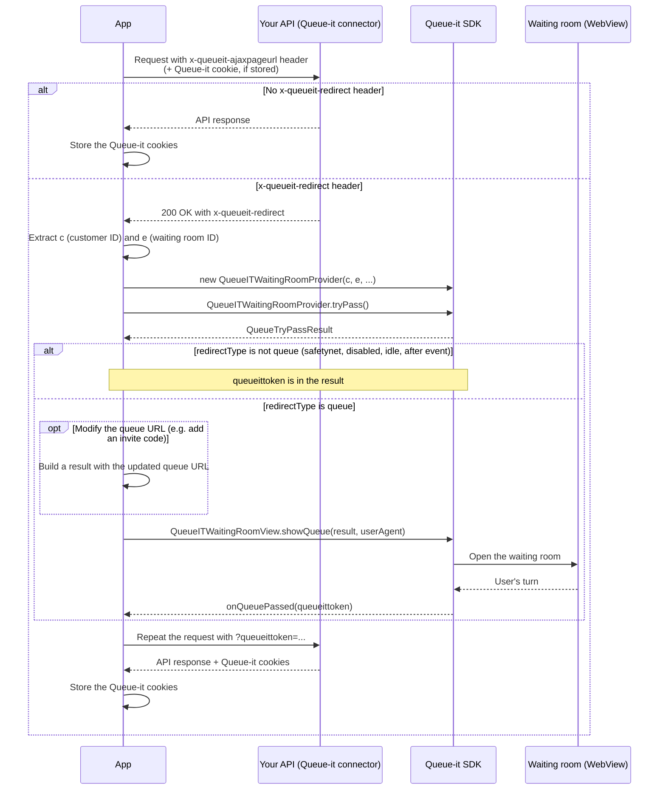

# Using Queue-it server-side connector (KnownUser) to protect APIs, consumed by mobile app
If you are using Queue-it's server-side connector (KnownUser) to protect your API, you utilize this in your mobile app, to run a hybrid setup.

This greatly increases the protection and prevents visitors from bypassing the client-side Queue-it integration.

The flow in this setup is the following (simplified):
1. Mobile app calls API endpoints and includes the special Queue-it header
   Endpoint is protected by Queue-it connector
2. Queue-it connector has Trigger/Condition setup to match an Integration Action/Rule, with Queue action-type
3. Queue-it connector intercepts the requests to API and immediately responds with another special Queue-it header, containing information needed to show the Waiting Room
4. Mobile app shows the waiting room using the header from the Queue-it server-side connector

## Sample app

The [demowithprotectedapi](../demowithprotectedapi) directory contains OkHttp interceptors (in the `http` package) for the header and cookie handling described below, that can be easily integrated.

> Note: the demo app's queue handling still uses the legacy `QueueITEngine.run`. Integrate the waiting room with `tryPass` and `showQueue` as described in the steps below.

## Implementation

To integrate with a protected API we need to handle the validation responses that we may get in case the user should be queued.

All calls to protected APIs need to include the `x-queueit-ajaxpageurl` header with a non-empty value and a Queue-it accepted cookie (if present).
The integration can be described in the following steps:

1. API Request with `x-queueit-ajaxpageurl` *or* Queue-it accepted cookie is made
2. We get a response which may either be the API response or an intercepted response from the Queue-it connector
3. Scenario 1, user should not be queued (response does not have the `x-queueit-redirect` header)
    1. We store the Queue-it cookies from the response, to include in later API calls
4. Scenario 2, user should be queued
    1. If the user should be queued we'll get a `200 Ok` response with a `x-queueit-redirect` header. We need to extract the `c`(Customer ID) and `e` (Waiting Room ID) query string parameters from the `x-queueit-redirect` header and pass them to a `QueueITWaitingRoomProvider`, then call `tryPass`, just as you would normally do with the SDK
    2. If the `QueueTryPassResult` has redirect type `queue`, we show the waiting room with `QueueITWaitingRoomView.showQueue` (optionally after [modifying the queue URL](../README.md#modifying-the-queue-url-before-showing-the-waiting-room)), wait for the `onQueuePassed` callback and store the QueueITToken passed to the callback. For any other redirect type (`safetynet`, `disabled`, `idle`, `afterevent`) the visitor can continue without queueing, and the QueueITToken is available from `QueueTryPassResult.getQueueItToken()`
    3. We can repeat the API request, this time appending the `queueittoken={QueueITToken}` query string parameter, to prevent the server-side connector from intercepting the call again
    4. We store the Queue-it cookies from the final response, so they can be set in other API calls

## Client-side and server-side mobile integration (hybrid) with Queue-it Behind Proxy (Bring your own CDN)
> Note: This only applies if you are using the Mobile SDK as a client-side protection *and* are using server-side protection using the Queue-it KnownUser Connector.

> If you are only using client-side protection, using the Mobile SDK, refer to the documentation in the [main documentation](../README.md)

If you are running Queue-it behind your own reverse proxy the Mobile Integration can also be setup to run behind your proxy. For the hybrid setup, your KnownUser connector will also need to run in "Behind Proxy" mode. Please contact Queue-it Support, for any questions the KnownUser Connector Behind Proxy Setup.

### Setup Mobile SDK with Behind Proxy, with protected API
To do this simply use your Proxy Domain as the `waitingRoomDomain` parameter to `QueueITWaitingRoomProvider` and `QueueITWaitingRoomView`, after getting the Queue-it intercepted response back from your API.

If you are running Queue-it Waiting Room on the same domain as your normal website, you also need to provide the `queuePathPrefix` parameter to both, to ensure your proxy can route the request to Queue-it origin.

This means in above [Implementation](#implementation) section, points 4.1 and 4.2, you must also provide `waitingRoomDomain` and optionally `queuePathPrefix` to `QueueITWaitingRoomProvider` and `QueueITWaitingRoomView`, to serve the Waiting Room through your reverse proxy.